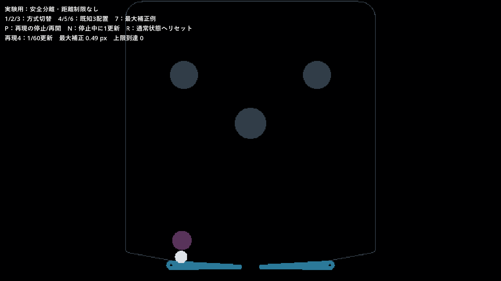
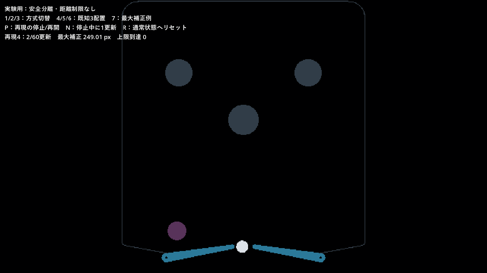

# ③解除時の安全分離：距離上限だけを外した比較（2026-11-23）

## 結果と採否

距離上限を外すと、近接Enemyの未解消は19→3配置へ減った。しかし最大249.01489 pxの水平補正、後続の通常接触による新規干渉5イベント、共有8接触の上限到達1配置、落下経路の増加が残る。全84配置を完走する要件を満たさず、現状のまま本番採用しない。

| 構成 | 完走 / 84 | 未解消終了 | 接触上限へ到達 | 最大補正 px |
| --- | ---: | ---: | ---: | ---: |
| 現行解除 | 84 | 0 | 2 | 60.60965 |
| 安全分離12 px | 65 | 19 | 0 | 9.14915 |
| 安全分離・距離制限なし | 81 | 3 | 1 | 249.01489 |

現行解除も実験用の3条件＋新接触法線分離を共通基準としている。従来の打球条件へ戻した比較ではない。未解消ではその試行を停止し、延期や大きい上向き補正へのフォールバックは行わない。完走は予定60更新まで試行したことを指し、上限到達による残り時間破棄とは別集計。

## 変更したもの・固定したもの

`release.gd`に距離判定の有効フラグを追加し、制限なし構成だけで無効にした。有限の接触法線・上下左右候補、短い順の検査、0.151 pxの分離余裕、0.03 pxの安全余裕、重なりを深める方向の棄却、補正先・補正経路の安全条件は維持した。診断用に補正直後の実座標と、候補先を塞ぐ物体名も記録した。

検出B・打球3条件・新接触の法線分離・③の左右共通管理・上向き探索16回・共有8接触は固定。本番main、PinballMotion、PinballFlippers、TableFlipper、Enemyは変更していない。ここでの最短は生成した候補内の最短であり、あらゆる方向からの最短安全位置ではない。

## 試験

- 前回の解除時1,728入力（開始重なり288×停止/回転×30/60/120 Hz）を3構成で再実行。
- 近接Enemy84配置を各60更新、1球/20球を各360更新。補正後も同じ応答で移動し、毎更新の座標・速度・接触・③・深さ・開口通過を記録。
- 既知の停止板2配置、回転中右側面、249 px補正の4配置を描画付きで再現。
- 通常接触4,644入力×3構成は前回の組み合わせ案の位置・速度と一致。前回の12 px制限付きと現行解除の1,728入力も一致。

停止/回転の判定と解除前照会は同じ時刻の姿勢を使う。周囲のEnemyは既存の更新順で進めた物理世界を使い、Enemyの過去姿勢復元は行わない。前回の独立安全検査（薄壁横断、開始重なりからの退出等）も通過した。

## 既知3配置

| 配置 ratio / gap / offset | 制限なしの結果 |
| --- | --- |
| 0.5 / 36 / 0、停止上面28.49 px | 未解消終了。上側2候補はEnemy、左側は下側壁Lower、右/下は方向条件で棄却 |
| 0.7 / 36 / 0、停止上面40.59 px | 同様に未解消終了 |
| 0.9 / 3 / 0、回転右側面24.49 px | 右へ24.64172 px補正、60更新完走、上限到達0。従来の上向き60.60965 pxより補正距離は小さい |

停止板2配置の『上限到達0』は、球を動かす前に未解消で終了したためであり、反復を解決した結果ではない。残る3件目はratio=0.7/gap=36/offset=36で、同じく上側がEnemy、左側がLower、右/下が方向条件で棄却された。

3配置での棄却理由は候補15個中、補正先の重なり9、重なりを深める方向6。各候補は最初の棄却理由を記録しており、後続条件もすべて評価したという意味ではない。『現在の候補と安全条件では見つからない』という結果で、安全な場所自体が存在しない証明ではない。

## 大きな補正と、その後の反復

最大補正はratio=0.15/gap=3/offset=0の更新1。上面の幾何的深さ12.16233 pxに対し、法線方向12.31333 pxと真上12.61523 pxの候補はEnemyで塞がれ、左/下候補は方向条件で棄却された。残った右方向249.01489 pxが採用され、球中心Xは693.13611→942.15100へ移動した。補正経路と補正先は安全条件を通過したが、位置の飛び自体がゲームとして自然かは別の判断である。





新しい上限到達はratio=0.99/gap=12/offset=36、更新1。解除前の安全分離後、残り時間内に左板と再接触し、従来の上向き補正とEnemy接触が繰り返されて8回へ到達。破棄時間は9.624652 ms。球の更新開始時には重なっていたという履歴を維持したため、補正後に区間開始が非接触でも、その更新内の独自再接触は上向き分離を使っていた。今回、この分類や反復上限を同時に変更していない。

## 干渉と落下の評価

距離制限なしの解除前分離23イベントは、補正直後に0.03 px余裕付きの左右板判定で接触0、周囲の接触0。しかし後続の通常処理では新規干渉5イベントが発生した。現行解除は24、12 px方式は0だが、後者は19配置で早期終了しているため、0をそのまま優位とは評価しない。

衝突再有効時の更新終了に残った板との重なりは、現行解除3イベント・最大1.13772 px、距離制限なし1イベント・最大0.00634 px。③で許可された通過や未解消終了時の内部状態はこの件数に含めない。

近接の全84配置でmainのリセット判定Yへ到達した入力は現行7、制限なし14。両方が完走した同じ81入力だけでも現行6→制限なし14となり、8入力で新たに到達した。解除前の補正そのもので直ちにリセット判定Yや開口の退出条件へ飛んだ例は0で、後続軌道の変化による。近接試験は途中で球をリスポーンさせず、判定位置への初回到達を観測した。落下の増加を不具合と断定はしないが、返球機会・操作感の判断材料として残す。

1球/20球の360更新は3構成とも完走、未解消・上限到達0。20球の最大補正は全構成2.84073 pxで、この6秒試験では深い解除時重なりの差を評価できていない。

## CPU：使える測定と使わない測定

長期の近接実行を診断なし版で比較する試みでは、225軌道中29軌道に位置差が生じ、厳しい位置/速度照合54件が不一致。終了位置差の最大は0.86345 px、速度差最大8.34573 px/sだった。同じ観測付き監査同士でも別実行で位置差があり、現行解除の前回比較で最大0.86345 pxを観測した。差の原因は未特定で、診断なし版固有の問題と断定しない。この長期CPU試行の時間は採用判断に使わない。

代わりに、毎回まったく同じ初期位置・速度へ戻す1更新の補助測定を実施した。履歴・面分類・周囲の観測ログは外し、安全に必要な照会は含めた。比較する全入力で未解消終了0、診断版との終了位置0.001 px未満・速度0.01 px/s未満の一致を確認。8巡中1巡をウォームアップとして除外し、方式順を巡回した。

| 同じ1,152入力・3構成とも処理完了 | 平均 µs | 中央値 µs | p95 µs | p99 µs |
| --- | ---: | ---: | ---: | ---: |
| 現行解除 | 94.33 | 78 | 206 | 289 |
| 安全分離12 px | 72.33 | 62 | 133 | 179 |
| 安全分離・距離制限なし | 71.55 | 62 | 131 | 180 |

| 同じ1,728入力・両構成とも処理完了 | 平均 µs | 中央値 µs | p95 µs | p99 µs |
| --- | ---: | ---: | ---: | ---: |
| 現行解除 | 95.31 | 81 | 203 | 276 |
| 安全分離・距離制限なし | 71.06 | 62 | 130 | 178 |

これは解除時の孤立した1更新のCPU負荷であり、ゲーム全体・近接Enemy全体の負荷改善を証明しない。失敗した12 px方式の576入力を3方式比較に混ぜていない。正確性・副作用の採用要件が未達のため、この補助値の改善だけで採用しない。

## 検証・再現・資料

精度/統合の機械検査135,239件と1更新CPUの検査50,696件、既存migration回帰96件は失敗0。長期CPU再現検査の54不一致は別記録として保持し、合格件数へ含めない。本番8ファイルのSHA-256を実行前後・最終集計で照合した。

Godot AIの描画付き再現は4配置×3構成＝12条件でCLIの終了位置・速度・未解消・上限到達・最大補正と一致。Pで停止してNで1更新進める操作も確認し、249 px補正の前後を保存した。確認後は実行停止した。

```powershell
godot --headless --fixed-fps 60 --path . --script res://experiments/flippers/tests/unlimited_audit.gd
godot --headless --fixed-fps 60 --path . --script res://experiments/flippers/tests/unlimited_step_benchmark.gd
godot --headless --path . --script res://pinball/tests/migration_test.gd
python experiments/flippers/tests/summarize_unlimited_audit.py
```

実験シーンは`unlimited_preview.tscn`。1＝現行解除、2＝12 px、3＝距離制限なし。4/5/6＝既知3配置、7＝249 px補正例を各1秒再現。P＝停止/再開、N＝停止中に1更新、R＝通常状態へ戻す。初期値は現行解除。距離制限なしの自然さはこの画面で確認できるが、今回の自動試験だけでは承認済みと扱わない。

- [全解除入力](unlimited_grid.json)、[近接・複数球・全更新の軌道](unlimited_audit.json)。
- [1更新CPU生データ](unlimited_step_benchmark.json)、[描画付き再現](unlimited_runtime.json)、[集計](unlimited_audit_summary.json)。
- [比較に使わない長期CPU再現診断](unlimited_benchmark.json)。`--verify`で再現する。失敗時は終了コード1が想定される。
- [前回の回復比較](release_audit.md)、[実験仕様](../shot_rules.md)。

詳細と実験ソース・再現入力・画像は、SHA-256付きの同一一式をDesktopにも保存する。
