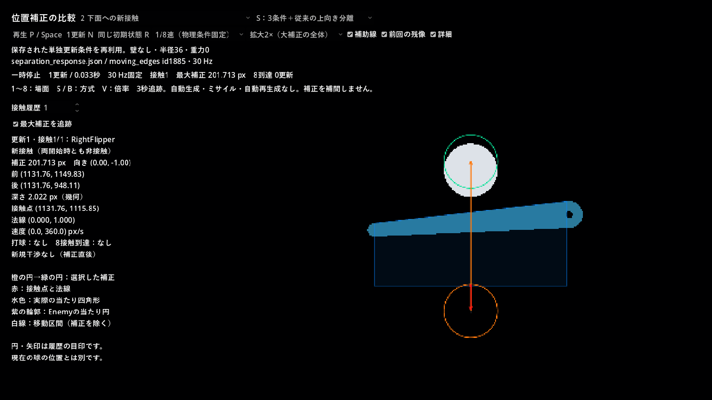
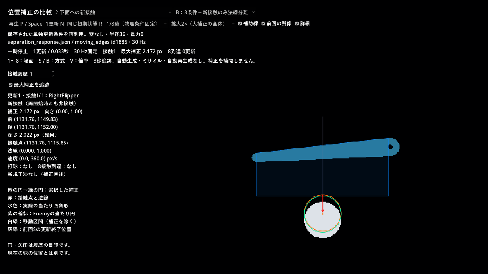

# 大きな位置補正の視覚比較

2026-11-24 / Godot 4.7.2 / `flipper`

8場面を選んで、SとBの補正とその後の球の動きを繰り返し観察する実験。見た目の許容可否はユーザーが判断する。本番反映、新しい衝突解決方式、③の仕様変更は行っていない。

## 1. 起動

Godotエディタで [separation_preview.tscn](separation_preview.tscn) を開き、**F6（現在のシーンを実行）**。F5は本番mainを起動する。実験シーンを起動しただけでは本番の起動設定は変わらない。

```powershell
godot --path . res://experiments/flippers/separation_preview.tscn
```

最初は場面1・B・一時停止・1/8速。画面上の「1更新」で最初の接触を確認できる。場面を替えた後も一時停止で始まる。

## 2. 操作と表示

| 操作 | 画面・キー |
| --- | --- |
| 場面を選ぶ | 左上の選択欄、または1〜8 |
| 方式を替え、同じ初期状態へ戻す | 方式選択欄、Sキー／Bキー |
| 現在の方式でリセット | 「同じ初期状態」、R |
| 再生・一時停止 | ボタン、P／Space |
| 物理更新を1回だけ進める | 「1更新」、N。一時停止になる |
| 再生速度 | 1/8速・1/4速・通常速度 |
| 表示倍率 | 拡大3×、大補正の全体を見る2×、接触中心の1×、本番の盤面表示1× |
| 拡大と1×の切替 | V。場面2・3は2×、その他は3×へ戻る |
| 過去の接触を選ぶ | 左の「接触履歴」の番号。最大補正の自動追跡を解除する |
| 最大の補正を見続ける | 「最大補正を追跡」 |
| 補助表示を隠す | 補助線・前回の残像・詳細のチェック |

場面3は「約204 pxの最大補正例」と「深さ48 px」の2条件、場面4はratio .5/.7の2条件を選べる。それ以外は1条件。球やEnemyを自由に編集する機能は追加していない。

**最初にSで1更新→Bへ切替→1更新**が比較しやすい。その後は再生して、残る接触・落下を確認する。「最大補正を追跡」中も球は現在の位置を描く。矢印の接触履歴と現在の球は同じ時点とは限らない。

| 色・表示 | 意味 |
| --- | --- |
| 橙の円→緑の円、橙矢印 | 選択した接触の補正前→補正直後 |
| 赤の点・矢印 | 接触点と法線。補正方向とは一致しないことがある |
| 水色の輪郭と薄い塗り | 実際の当たり四角形。見た目の丸い棒とは別 |
| 紫の輪郭 | Enemyの当たり円。成長・被弾表現による見た目の大きさとは別 |
| 白線 | 記録した接触間の移動区間。補正をこの白線へ混ぜない |
| 灰線 | 同じ場面・同じ条件の前回試行の更新終了位置。物理物体ではない。線は更新位置を結んだ参考表示で、途中軌跡の正解ではない |

低速は固定した物理更新の間隔を広げる方式。`Engine.time_scale`や1更新のdeltaを小さくせず、補正位置を補間しない。表示側の物理補間もこの実験では無効。場面2だけ30 Hz、その他は60 Hzを固定する。

接触後は最大3秒を追跡し、元の落下判定位置に達したら終了する。「落下位置へ到達」と「8接触到達」を別表示する。自動再生成は行わず、Rで同じ条件へ戻す。終了後の再生ボタンは無効になる。

1×の接触中心表示はカメラの平行移動を含む。「本番の盤面表示1×」は元の座標配置。いずれも同じウィンドウのストレッチに対して本番と同じ倍率であり、必ずしも画面の1物理pixel＝1ゲームpxとは限らない。

## 3. 8場面の再現範囲と対応資料

| ID | 使用した状態と再現範囲 | 元データとの関係 |
| --- | --- | --- |
| 1 右側面への新接触 | 球の直前位置・速度と、保持開始後の板10°を再構築。壁は元の配置 | `value_isolated_A_held_113_60.json`のA・更新2853。最初の補正93.41048 px・接触点・法線を再現。18Enemyと長時間の履歴は未復元なので、元の盤面全体の完全再現ではない |
| 2 下面への新接触 | 保存された入力をそのまま使用。右、18°から戻る板、r36、30 Hz、重力0。壁・他板を衝突対象から外し、表示も隠す | `separation_response.json`のmoving_edges id1885。単独1更新の補正・返球結果を照合した。後続更新は同じ孤立条件で追加観察 |
| 3 開始時の重なり | 開始288条件のうち、左・下面・18°・r36・depth0.2。重力0・壁なし。深さ48 pxにも切替可能 | `separation_diagnostics.json`のoverlaps。204.18 pxは食い込み深さではなく、真上へ抜く距離。最大例は浅い0.20 pxであり「204 px深く埋まった」とは扱わない |
| 4 停止板内部で③解除 | 元の近接条件を初期状態から実行。球は上面から28 px・下向き300、Enemyはその90 px上。左右を保持。ratio .5/.7 | causalの(.5,36,0)/(.7,36,0)。3更新目の停止板での内部解除と8接触到達を確認。板・Enemyの標準回復の微差により、深さや後続位置は旧記録と完全一致しない |
| 5 回転板側面で③解除 | causalの更新1・球処理直前の位置・速度・③状態を復元。板は10°から18°へ。Enemyを除いて分離方向を観察 | (.9,3,0)の局所状態。深さ24.49072・補正60.60965 pxを再現。全履歴を再実行した場面ではない |
| 6 補正による周囲干渉 | 5と同じ状態に、保存されたEnemy位置・速度・ノックバック・健康値を戻す。最初だけEnemyの再移動をせず、球処理直前の状態を使う | causalの同例。上向き60.60965 pxがEnemyへの新規干渉を作る。照会履歴の完全復元ではない |
| 7 再生成時の重なり | 球は(780,540)・速度0。Enemy中心を保存された接触点、法線、半径30から推定。移動速度は0として置く近似 | valueの更新4902。約20.50877 pxの標準回復を確認したが、元のEnemy移動・全36体・健康状態・履歴は未復元。同じ数値でも完全再現とは呼ばない |
| 8 通常の上辺打球 | 左上面中央から28 px、下向き300。Enemyなし。実際の壁・板・重力 | causalのflipper_onlyと同種の対照条件。大補正ではなく通常打球が維持されるかを見る |

各場面の出典・近似表示は、場面を選ぶたび画面上にも表示する。元データのseedだけを再生して一致したという扱いはしていない。コンパクトな入力と出典は [separation_scenes.json](evidence/separation_scenes.json) に保存した。

## 4. S／Bで変わった補正

Sは3条件＋上向き分離、Bは3条件＋新接触のみ法線分離。両方式で検出B、反射・返球、③、共有8接触を共用する。Bの法線分離は更新開始・区間開始の両方で非接触の独自接触だけ。初期重なりとGodot標準回復は変更していない。

| 場面 | Sの代表補正 | Bの代表補正 | 何を見比べるか |
| --- | --- | --- | --- |
| 1 | 上93.410 px | 左0.287 px | 右板の側面から上へ飛ぶ動きと、接触側に小さく戻す動き |
| 2 | 上201.713 px | 下2.172 px | 下面から上面側へ移る補正と、下面側へ出る補正 |
| 3 最大例 | 上204.180 px | 上204.180 px | 新接触ではないため、Bでも残る大補正 |
| 3 深さ48 px | 上156.381 px | 上156.381 px | 深い初期状態でも現行方針を維持していること |
| 4 ratio .5 | 標準回復最大約24.824 px | 約24.821 px | 深さ約28.49 pxでの再有効化、同じ更新の8接触 |
| 4 ratio .7 | 標準回復最大約35.414 px | 約35.351 px | 深さ約40.66／40.59 pxでの再有効化。最初の打球・補正後に軌道が変わり得る |
| 5 | 上60.610 px | 上60.610 px | ③解除の既存重なりに法線分離が適用されないこと |
| 6 | 上60.610 px | 上60.610 px | 補正で新しくEnemyへ押し込むこと |
| 7 | 左下20.509 px | 左下20.509 px | 両方式共通のGodot標準回復 |
| 8 | 上向き約1.233 px | 法線方向約1.220 px | 小さい位置差と正常な打球。最初の速度は両方(364.821, -2262.384) px/s |

数値は今回のローカル試行で、標準接触の最終桁や後続経路の保証値ではない。場面1の補正前は約(978.137,1073.877)。Sは(978.137,980.466)、Bは(977.850,1073.877)へ補正した。場面2は約(1131.757,1149.826)から、Sがy948.113、Bがy1151.998へ移す。矢印で距離だけでなく行き先を確認できる。

下面の例、S：



同じ初期状態のB：



## 5. 両方式に残るもの

場面3・5・6・7を改善した方式ではない。開始重なりの真上分離、③解除時の大補正、停止板・Enemyの標準回復、接触後の反復はそのまま観察できる。Bの法線分離をすべての接触へ拡大したり、8回を増やしたりしていない。

最大補正は更新内の途中の位置である。緑の円が安全そうでも、その後の接触で再び動く場合がある。接触履歴を順に選び、現在の白い球と分けて確認する。補正をゆっくり連続移動させる表示は行っていない。

## 6. 周囲干渉と後続挙動

* 場面1は、この局所配置では両方式とも短時間で落下判定位置へ達した。元の18Enemyを戻していないため、元ゲームの落下結果の再現や生存率の優劣には使わない。
* 場面2はSが上面側へ移され、Bは下面側のまま落下位置へ向かう。どちらをゲームとして自然と感じるか、ユーザーが判断する。下面の試験は重力0であり、通常の落下条件とは異なる。
* 場面3は重力0・初速度0の保存条件なので、補正後はその位置に静止する。再生が壊れて停止したのではない。
* 場面4は両条件・両方式とも、今回の3秒以内に8接触へ達した更新が1回。ratio .5は後に落下位置へ達し、.7は3秒後も盤面上に残った。順序・深さを見て、回復反復と通常の再衝突を区別する。
* 場面5は両方式に60.61 pxが残り、その後も接触する。Enemyを取り除いても分離方向による大きな移動が残ることを確認できる。
* 場面6は最初の補正でEnemyへ約6.289 pxの幾何的食い込みを作る。両方式とも同じ更新で8接触へ達し、その後は盤面上を移動した。緑の補正直後位置と、同じ更新末の白い球が異なる場合がある。
* 場面7の最初の標準回復は同じ。後続3秒の終点はわずかにずれた。Enemy移動の完全再現ではなく、復帰近似の観察として扱う。
* 場面8は最初の打球状態・速度が一致。その後の位置差から軌道が分かれることがある。長い終点の一致を、打球式を維持したことの判定に使わない。

標準接触の矢印は、同じ開始変換の読み取り専用照会のsafe fractionを使い、移動分を除いた実効的な非時間変位を表示する。移動時間を修正した実験ではなく、標準ラッパーが内部で投影する前の回復ベクトルそのものでもない。周囲の干渉は当該補正時の観測で、後続更新の安全性保証ではない。

## 7. 再利用と変更範囲

既存の `separation_preview.tscn` とそのスクリプトを拡張した。新しい並列盤面・独自の衝突解決器は作っていない。

* 本番mainのシーン、球・壁・フリッパー・Enemy、`shot_policy.gd`、既存の `value_motion.gd` を再利用。打球・反射・ダメージを表示用に複製していない。
* [separation_scenes.gd](separation_scenes.gd)：代表入力の配置と、既存順序での板→Enemy→球の手動更新。
* [separation_view_motion.gd](separation_view_motion.gd)：既存レコーダーへ表示用の深さ・分類・補正両端を追加。
* [separation_overlay.gd](separation_overlay.gd)：円・矢印・実際の当たり形状・参考履歴の描画。物理ボディは追加しない。
* [build_separation_scenes.py](tests/build_separation_scenes.py)：既存データから小さい8場面の入力集を作る。

この実験は局所シナリオとして自動生成、経路・群衆処理、ミサイル、自動再生成を実行しない。Enemyの移動・ノックバック・ダメージの本体は既存実装を呼ぶ。場面7の静止Enemyは近似条件であり、本番Enemyの速度を変更したものではない。

計測の追加照会と描画は観察用。高密度の接触時刻参照は無効にしているが、本番の処理時間の測定には使わない。描画のチェック切替は表示だけに作用する。

## 8. 検証と未確認事項

CLIで8場面＋場面3/4の副条件、S/Bの計20試行を最大3秒まで進めた。[130検査・失敗0](evidence/separation_view.json)。S/Bの初期位置・速度・板角度・③状態・Enemy状態の一致を確認した。保存された下面・初期重なりの補正値も照合した。

8場面×2方式について、最初の1更新の観測あり／既存の診断なし部品の位置・速度を照合。1/8速の8回のスケジュール呼び出しが固定1更新と一致し、`Engine.time_scale=1`を維持することも確認した。

Godot AIで対象Editor sessionを指定して、8場面×S/Bの16試行を描画付きで3更新ずつ実行。[描画付き結果](evidence/separation_view_runtime.json)とCLIの初期状態・最初の補正・速度・打球状態を照合した。全16で最初の値が一致した。画面キャプチャで補正矢印・当たり形状・履歴表示を確認し、実際のマウスによる「1更新」クリック、場面キーも確認した。表示による自然さの合格判定ではない。

本番13ファイルのSHA-256は前回調査から一致。起動設定変更、commit、push、Desktopへの複製は行っていない。[照合集計](evidence/separation_view_summary.json)

再検証：

```powershell
python experiments/flippers/tests/build_separation_scenes.py
godot --headless --fixed-fps 60 --path . --script res://experiments/flippers/tests/separation_view_test.gd
python experiments/flippers/tests/summarize_separation_view.py
```

描画付き再実行はこのシーンをGodot AIから起動し、`load("res://experiments/flippers/tests/separation_runtime.gd").new().run(get_tree().current_scene)`をawaitする。旧4方式の `separation_runtime.json` は過去の記録として保存し、今回の結果で上書きしない。

未確認なのは、人間が見たときの不自然さの許容、元の長時間盤面全体の完全な再現、全条件での後続軌道の厳密一致、描画込みの性能保証である。全4,644条件や近接84配置を手操作で巡回する機能は追加していない。
